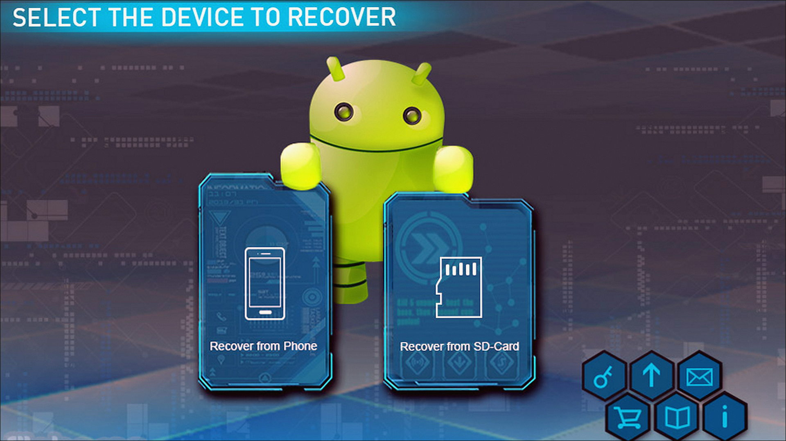
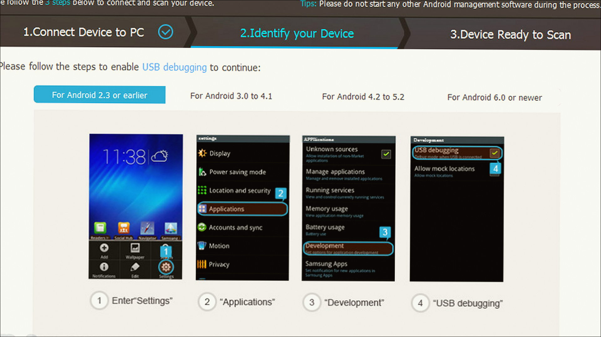
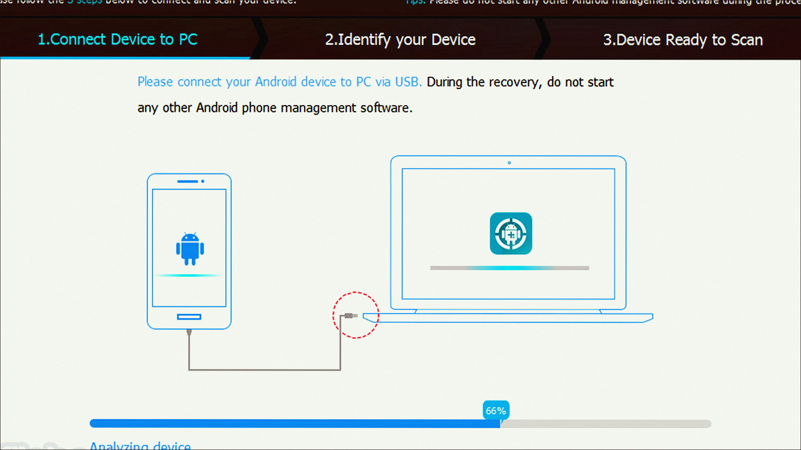

# Windows notes: MiniTool Partition Wizard

**MiniTool** · 13.6 · 90 MB · System catalog

[Open card](https://moggydayprogram.com/programs/minitool-partition-wizard) · [English](https://moggydayprogram.com/en/programs/minitool-partition-wizard) · [GitHub Pages](https://cavernwithinshow.github.io/minitool-partition-wizard-windows/?lang=en)

  
  
  

Разделы как у AOMEI. Technician, русский.

MiniTool Partition Wizard on Windows 10/11 x64. 90 MB. Requirements, screenshots, MoggyDay Launcher.

Get it from the catalog card, not from this repository.

| Field | Value |
| --- | --- |
| Build | 13.6 Technician |
| OS | Windows 10/11 x64 |
| Pages | https://cavernwithinshow.github.io/minitool-partition-wizard-windows/ |

- [EaseUS Partition Master](https://moggydayprogram.com/programs/easeus-partition-master)
- [MiniTool Power Data Recovery](https://moggydayprogram.com/programs/minitool-power-data-recovery)
